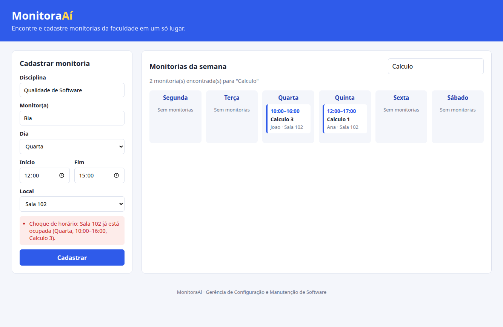
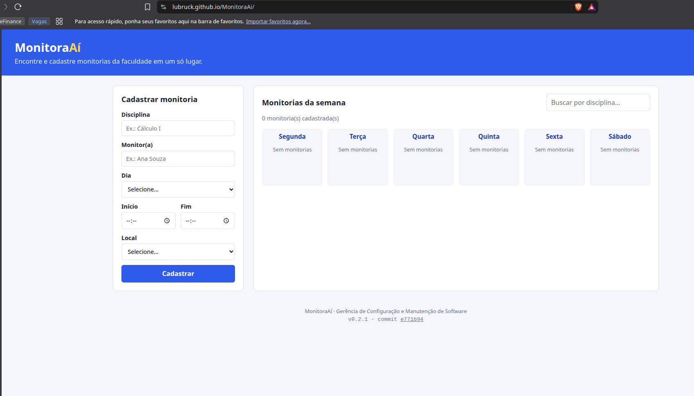
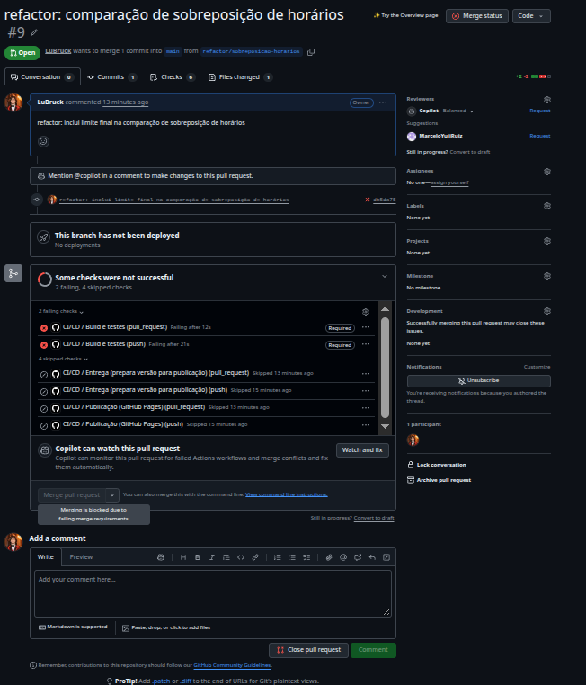
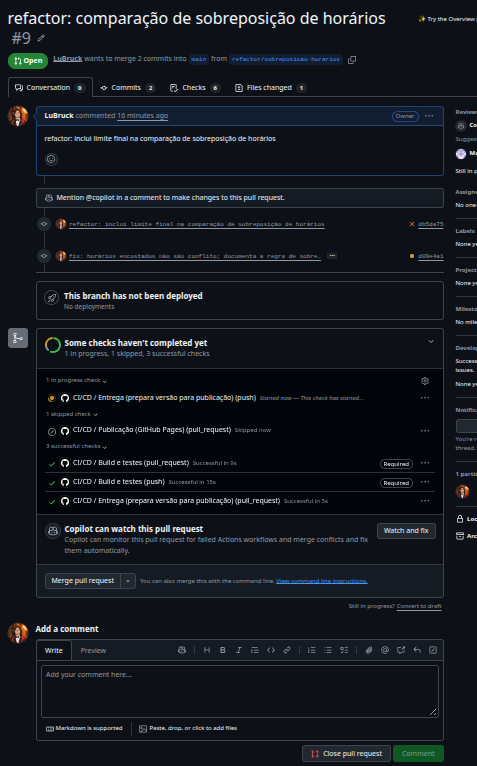

# 1. Identificação do projeto e da equipe

| Item | Informação |
|---|---|
| Aplicação | **MonitoraAí**: cadastro e consulta de monitorias acadêmicas |
| Equipe | Grupo 3 |
| Disciplina | Gerência de Configuração e Manutenção de Software (ES46B) |
| Curso / turma | Engenharia de Software / ES61 (2026_02) |
| Repositório | <https://github.com/LuBruck/MonitoraAi> |
| Aplicação publicada | <https://lubruck.github.io/MonitoraAi/> |
| Versão entregue | **v0.2.1**, commit `e771b94` |

| Integrante | Usuário no GitHub | Responsabilidade principal |
|---|---|---|
| Lucas Bruck | `LuBruck` | Líder de integração e engenheiro de pipeline: organização do repositório, revisão e merge de *pull requests*, interface da aplicação, CI/CD e publicação |
| Marcelo Yuji Ruiz | `MarceloYujiRuiz` | Desenvolvedor: regras de negócio (cadastro, validações, detecção de conflito e busca) |
| Julia Pivello | `juliapivello` | Testes e qualidade: testes automatizados, execução local e organização das primeiras evidências |

A divisão indica a responsabilidade principal de cada pessoa, e não um trabalho isolado. As alterações chegaram à branch principal por *pull requests* revisados, e todos os integrantes acompanharam o funcionamento geral da aplicação e do pipeline.

# 2. Introdução e contextualização

Na faculdade, as informações sobre monitorias ficam espalhadas em murais, grupos de mensagens e avisos em sala: qual disciplina, quem é o monitor, em que dia, horário e sala. O aluno que precisa de ajuda não tem um lugar único para descobrir quando e onde há monitoria da disciplina que procura. Do lado de quem organiza, é comum marcar duas monitorias na mesma sala e no mesmo horário.

O **MonitoraAí** centraliza o cadastro e a consulta dessas monitorias numa página web simples, com busca por disciplina, uma grade semanal e um bloqueio automático de choque de horário no mesmo local. O público é formado por alunos que procuram monitoria e por monitores ou coordenadores que cadastram os horários.

A proposta é pertinente porque resolve um problema real do dia a dia acadêmico com uma aplicação pequena, adequada ao foco da disciplina: mostrar um processo confiável de versionamento, integração, testes e entrega.

# 3. Escopo e funcionalidades da aplicação

## 3.1 Funcionalidades implementadas

| # | Funcionalidade | Tipo |
|---|---|---|
| F1 | **Cadastrar monitoria** com disciplina, monitor, dia, horário de início, horário de fim e local | Manipulação de dados |
| F2 | **Listar as monitorias da semana** de segunda a sábado, agrupadas por dia e ordenadas pelo horário de início | Consulta |
| F3 | **Buscar por disciplina**, sem diferenciar maiúsculas, minúsculas ou acentos ("calculo" encontra "Cálculo I") | Consulta |
| F4 | **Exibir versão e commit publicados** no rodapé, com link para o commit no GitHub | Rastreabilidade |

## 3.2 Dados manipulados

Cada monitoria é um objeto com `id`, `disciplina`, `monitor`, `dia`, `inicio`, `fim` e `local`. Os registros ficam no **localStorage** do navegador, na chave `monitoraai:monitorias`. O **dia** é escolhido de uma lista fixa (Segunda a Sábado), e o **local** também (Sala 101, Sala 102, Sala 204, Lab 1, Lab 2 e Biblioteca). Assim, a mesma sala não aparece escrita de formas diferentes, o que é essencial para a detecção de conflito funcionar.

## 3.3 Validações

| # | Validação | Mensagem exibida |
|---|---|---|
| V1 | Todos os campos são obrigatórios, e um campo só com espaços é considerado vazio | "Monitor é obrigatório." (e assim por diante para cada campo) |
| V2 | Dia e local precisam ser valores da lista | "Dia inválido…" / "Local inválido…" |
| V3 | Horário no formato HH:MM, com início antes do fim | "O horário de início deve ser antes do horário de fim." |
| V4 | Não pode haver choque de horário no mesmo local e no mesmo dia. Horários encostados (10:00–12:00 e 12:00–14:00) são permitidos | "Choque de horário: Sala 204 já está ocupada (Segunda, 10:00–12:00, Cálculo I)." |



## 3.4 Fora do escopo

Seguindo a recomendação do enunciado, ficaram de fora: login e autenticação, banco de dados remoto, edição e remoção de monitorias e notificações. Como os dados ficam no localStorage, cada navegador tem a sua própria lista, e não há compartilhamento entre usuários (ver Seção 12).

# 4. Tecnologias e ambiente de desenvolvimento

| Tecnologia | Finalidade no projeto |
|---|---|
| HTML5, CSS3 e JavaScript (sem framework) | Interface e regras da aplicação |
| localStorage | Persistência local dos registros, sem servidor |
| Node.js 22 e npm | Execução dos scripts de build e testes; `package-lock.json` fixa as versões das dependências |
| Jest 29 | Testes automatizados |
| Git e GitHub | Controle de versão, branches, *pull requests*, revisão e proteção da `main` |
| GitHub Actions | Pipeline de CI/CD (`.github/workflows/ci-cd.yml`) |
| GitHub Pages | Hospedagem da versão publicada |
| GitHub Environments | Ambiente `github-pages` com aprovação manual antes da publicação |

**Decisão de arquitetura.** As regras de negócio ficam em `src/js/monitorias.js`, como **funções puras**, sem acesso ao HTML ou ao localStorage. A interface (`src/js/app.js`) só lê o formulário, chama essas funções e desenha o resultado. Com isso, a mesma lógica roda no navegador e é testada pelo Jest no Node, sem precisar de navegador no pipeline.

**Como executar.**

```bash
git clone https://github.com/LuBruck/MonitoraAi.git
cd MonitoraAi
npm ci              # instala as dependências exatas do package-lock.json
npm test            # roda os testes automatizados
npm run build       # gera a pasta dist/
cd dist && python3 -m http.server 8080   # abre em http://localhost:8080
```

Para usar a aplicação basta acessar <https://lubruck.github.io/MonitoraAi/>. Ela também abre direto pelo `src/index.html`, mas nesse caso o rodapé mostra "versão de desenvolvimento".

# 5. Organização do trabalho e gerência de configuração

## 5.1 Estrutura do repositório

```text
MonitoraAi/
├── .github/workflows/ci-cd.yml   # pipeline CI/CD
├── docs/
│   ├── planejamento.md           # escopo, papéis e cronograma (Missão 01)
│   ├── documento-tecnico.md      # fonte deste documento
│   └── evidencias/               # capturas usadas como evidência
├── scripts/build.js              # etapa de build
├── src/
│   ├── index.html
│   ├── css/style.css
│   └── js/
│       ├── monitorias.js         # regras de negócio (testadas)
│       └── app.js                # interface + localStorage
├── tests/monitorias.test.js      # testes automatizados (Jest)
├── package.json / package-lock.json
└── README.md
```

## 5.2 Fluxo de branches e integração

A equipe adotou um fluxo baseado em *feature branches*:

- **`main`**: versão estável. Depois da configuração inicial, só recebe código por *pull request*.
- **Branches por tipo de mudança**, com prefixo: `feature/` (funcionalidade), `ci/` e `cd/` (pipeline), `fix/` (correção), `refactor/` (refatoração) e `docs/` (documentação e evidências).
- **Mensagens de commit** no padrão *Conventional Commits* (`feat:`, `fix:`, `test:`, `ci:`, `build:`, `docs:`, `chore:`), para que o tipo de cada mudança fique claro no histórico.

| PR | Branch | Autor | Conteúdo |
|---|---|---|---|
| #1 | `feature/logica-monitorias` | Marcelo | Regras de cadastro, validação, conflito e busca |
| #2 | `feature/testes` | Julia | Testes automatizados (Jest) |
| #3 | `docs/evidencias-fase2` | Julia | Evidência da execução local dos testes |
| #4 | `feature/interface` | Lucas | Página, estilo e integração com localStorage |
| #5, #6 | `ci/pipeline` | Lucas | Script de build, workflow de CI e evidências |
| #7 | `cd/github-pages` | Lucas | Jobs de entrega e publicação; versão no rodapé |
| #8 | `fix/rodape-versao` | Lucas | Arquivos do rodapé de versão que ficaram de fora do PR #7 |
| #9 | `refactor/sobreposicao-horarios` | Lucas | Simulação de falha e correção (Seção 9) |
| #10 | `docs/evidencias-fase4` | Lucas | Evidências de CD, falha e recuperação |

A ordem de integração respeitou as dependências entre as partes. A lógica (PR #1) entrou primeiro, porque os testes (PR #2) e a interface (PR #4) dependem dela. Isso evitou conflitos de merge: cada branch partiu da `main` atualizada e mexeu em arquivos diferentes.


## 5.3 Proteção da branch principal

Um *ruleset* chamado `protege-main` foi aplicado à `main`, sem ninguém na lista de exceções (*bypass list*). Ele:

- impede excluir a branch e fazer *force push*;
- exige que toda alteração entre por *pull request*;
- exige que o *status check* **Build e testes** esteja aprovado antes do merge.

Com isso, o pipeline deixa de ser só informativo: um PR com testes falhando **não pode** ser integrado (Figura 15).


## 5.4 Controle de versões da aplicação

A versão segue o *versionamento semântico* no `package.json`: `0.1.0` no desenvolvimento, `0.2.0` com a entrega contínua e `0.2.1` com a correção de defeito da Seção 9. O build grava essa versão e o commit no arquivo `version.json`, que a página exibe no rodapé (Seção 10).


# 6. Construção do pipeline de CI

**Arquivo:** `.github/workflows/ci-cd.yml` · **Ferramenta:** GitHub Actions

## 6.1 Eventos que disparam o pipeline

```yaml
on:
  push:
    branches: ['**']        # todo push, em qualquer branch
  pull_request:
    branches: [main]        # todo PR destinado à main
  workflow_dispatch:        # execução manual pela aba Actions
```

Cada push numa branch de trabalho dá retorno rápido a quem está desenvolvendo, e todo PR para a `main` é verificado antes da integração.

## 6.2 Job "Build e testes"

| Passo | Comando / ação | Finalidade |
|---|---|---|
| 1 | `actions/checkout@v7` | Baixa o código do commit que disparou a execução |
| 2 | `actions/setup-node@v7` (Node 22, cache npm) | Prepara o ambiente de execução |
| 3 | `npm ci` | Instala **exatamente** as versões do `package-lock.json` (build reprodutível) |
| 4 | `npm run build` | Etapa de build (abaixo) |
| 5 | `npm test -- --ci` | Executa os testes automatizados; um teste falhando encerra o job com erro |
| 6 | `actions/upload-artifact@v7` | Guarda a pasta `dist/` como artefato `monitoraai-<commit>` por 30 dias |

O runner foi fixado em `ubuntu-24.04` (em vez de `ubuntu-latest`), para que o ambiente do pipeline não mude sem a equipe saber. Essa decisão veio de um aviso do próprio GitHub sobre a migração do `ubuntu-latest` (Figura 7).

## 6.3 Etapa de build (`scripts/build.js`)

A aplicação é estática e não precisa ser compilada. Mesmo assim, o build tem uma função clara: **montar e validar o pacote de entrega**. Ele:

1. limpa e recria a pasta `dist/` a partir de `src/`;
2. verifica se os arquivos essenciais existem e não estão vazios (`index.html`, `style.css`, `monitorias.js` e `app.js`);
3. verifica se todo CSS e JS referenciado no `index.html` existe de fato;
4. grava `dist/version.json` com a versão, o commit, a branch, o link da execução no Actions e a data.

Se alguma verificação falhar, o script termina com código 1 e o pipeline para. Isso foi testado removendo o `app.js`: o build falhou com "arquivo essencial ausente: js/app.js".


# 7. Plano e execução dos testes automatizados

**Arquivo:** `tests/monitorias.test.js` · **Ferramenta:** Jest · **Comando:** `npm test`

Os testes verificam as **regras reais** da aplicação, chamando as mesmas funções que a interface usa.

| Teste | Comportamento verificado | Resultado esperado |
|---|---|---|
| **T1** | Busca por disciplina ignorando caixa e acento | Buscar "CALCULO" retorna só "Cálculo I" e "Cálculo II" |
| T1b | Busca com termo vazio | Retorna todas as monitorias |
| **T2** | Detecção de conflito | Mesma sala, mesmo dia, 11:00–13:00 contra 10:00–12:00 → conflito; o cadastro é recusado e a lista não muda |
| **T3** | Campo obrigatório vazio | Monitor só com espaços → inválido, com a mensagem "Monitor é obrigatório." |
| T4 | Ausência de falso conflito | Horário encostado (12:00–14:00), outra sala ou outro dia → sem conflito |
| T5 | Horário invertido | Início 14:00 e fim 13:00 → inválido |
| T6 | Cadastro válido e grade | Duas monitorias cadastradas aparecem na segunda-feira em ordem de horário |

T1, T2 e T3 correspondem diretamente aos três testes definidos no planejamento ("busca por disciplina", "detecta conflito" e "rejeita campo vazio"). T4, T5 e T6 cobrem os limites dessas regras. O T4 foi justamente o teste que detectou o defeito introduzido na simulação de falha (Seção 9).

**Resultado:** 7 testes aprovados, tanto localmente (Figura 9) quanto em todas as execuções do pipeline na `main`.


# 8. Entrega contínua, artefato e publicação

## 8.1 Jobs de CD

O workflow foi estendido com dois jobs encadeados pelo `needs`:

```text
Build e testes ──► Entrega ──► Publicação (GitHub Pages)
     (CI)            (CD)        só na main + aprovação manual
```

- **Entrega** (`needs: build-e-testes`): baixa o artefato `dist/` **exatamente como foi validado pelo CI** e o empacota no formato do GitHub Pages (`actions/upload-pages-artifact`). Roda em qualquer branch, mas só se os testes passaram. É a "versão pronta para entrega".
- **Publicação** (`needs: entrega`): publica com `actions/deploy-pages`. Tem três salvaguardas:
  - `if:` só executa na `main`, nunca a partir de um PR;
  - usa o *environment* `github-pages`, que exige **aprovação manual de um revisor**;
  - `concurrency: pages` impede duas publicações simultâneas.

  As permissões `pages: write` e `id-token: write` são dadas **só** a esse job. O resto do workflow tem apenas leitura do código.

## 8.2 Artefato

O artefato de entrega é o conteúdo da pasta `dist/`: `index.html`, `css/`, `js/` e `version.json`. Ele aparece em dois formatos:

- `monitoraai-<commit>`: artefato do CI, disponível para download por 30 dias em cada execução;
- `github-pages`: o mesmo conteúdo empacotado para o GitHub Pages, que é o que efetivamente vai ao ar.

O código publicado **não** é recompilado a partir da pasta do repositório. É o mesmo pacote que passou pelos testes.

## 8.3 Entrega contínua × implantação contínua

| | Continuous **Delivery** (adotada) | Continuous **Deployment** |
|---|---|---|
| Após os testes passarem na `main` | A versão fica **pronta** e o job de publicação fica *Waiting* | Publica automaticamente |
| Quem decide ir para produção | Uma pessoa aprova em "Review deployments" | O próprio pipeline |
| No MonitoraAí | Environment `github-pages` com *Required reviewers* | Bastaria remover o revisor obrigatório |

A equipe escolheu a **entrega contínua** porque ela atende ao enunciado e deixa uma decisão humana explícita antes de cada publicação, sem perder a automação: depois da aprovação, a publicação acontece sozinha.

**Critério de aprovação.** A aprovação é dada quando o merge altera a aplicação (`src/`, `scripts/` ou dependências). Merges que só adicionam documentação ou evidências, como o PR #10, **não** são aprovados para publicação: os testes e a entrega rodam normalmente, mas a versão no ar continua sendo a da última mudança de código. Por isso, a versão entregue (v0.2.1, commit `e771b94`) não é o último commit da `main`, e sim o último commit que alterou a aplicação. Essa é exatamente a flexibilidade que a entrega contínua oferece em relação à implantação contínua.


## 8.4 Verificação do acesso

Depois de cada aprovação, o acesso foi conferido abrindo o endereço publicado e o arquivo `https://lubruck.github.io/MonitoraAi/version.json`. Na versão final ele mostra:

```json
{
  "versao": "0.2.1",
  "commit": "e771b9466ff8042aec62aab3104db74f7cbf9e23",
  "branch": "main",
  "execucao": "https://github.com/LuBruck/MonitoraAi/actions/runs/45249932743"
}
```



# 9. Simulação de falha, bloqueio e recuperação

## 9.1 Alteração que provocou a falha

Para simular um defeito realista, abrimos a branch `refactor/sobreposicao-horarios` com uma "simplificação" na comparação de horários, trocando `<` por `<=`:

```diff
-      horaParaMinutos(a.inicio) < horaParaMinutos(b.fim) &&
-      horaParaMinutos(b.inicio) < horaParaMinutos(a.fim)
+      horaParaMinutos(a.inicio) <= horaParaMinutos(b.fim) &&
+      horaParaMinutos(b.inicio) <= horaParaMinutos(a.fim)
```

Commit `db5da75`: *refactor: inclui limite final na comparação de sobreposição de horários*. Parece inofensivo, mas quebra uma regra de negócio: uma monitoria das 10:00 às 12:00 passaria a "conflitar" com outra que começa às 12:00 na mesma sala.

## 9.2 Resultado do pipeline

O job **Build e testes** falhou no passo de testes, com `1 failed, 6 passed`. O teste reprovado foi o **T4** ("não acusa conflito em horários encostados ou em outra sala"). Como consequência, os jobs **Entrega** e **Publicação** ficaram como **skipped**: nenhum pacote foi preparado e nada foi publicado.

## 9.3 Bloqueio da publicação e do merge

Na primeira tentativa (Figura 14), o pipeline bloqueou corretamente a entrega e a publicação, mas o botão de merge do PR continuava habilitado. Investigamos e descobrimos que o *ruleset* da `main` estava ativo, porém com as regras de PR e de *status checks* **sem nenhum check obrigatório configurado**. O check "Build e testes" foi adicionado como obrigatório e, ao recarregar o PR, o GitHub passou a exibir os checks como **Required** e a mensagem **"Merging is blocked due to failing merge requirements"** (Figura 15).

O bloqueio acontece, portanto, em duas camadas:

1. **No pipeline**: o `needs` impede que a entrega e a publicação rodem depois de uma falha.
2. **No repositório**: o *ruleset* impede que o código com falha chegue à `main`, de onde sairia a publicação.




## 9.4 Correção

Na mesma branch, o commit `d09e4a1` (*fix: horários encostados não são conflito; documenta a regra de sobreposição*) restaurou a comparação com `<`. Ele também acrescentou um comentário explicando a regra, para evitar que alguém faça a mesma "simplificação" no futuro, e subiu a versão para **0.2.1**.

## 9.5 Nova execução

A nova execução passou nos testes (7 de 7) e liberou o job de Entrega. O PR foi integrado (merge `e771b94`), a publicação foi aprovada no environment e a versão **0.2.1** foi ao ar.




# 10. Resultado final e rastreabilidade

| Item | Valor |
|---|---|
| Repositório | <https://github.com/LuBruck/MonitoraAi> |
| Aplicação publicada | <https://lubruck.github.io/MonitoraAi/> |
| Versão entregue | **0.2.1** |
| Commit da versão entregue | `e771b94` (merge do PR #9): <https://github.com/LuBruck/MonitoraAi/commit/e771b9466ff8042aec62aab3104db74f7cbf9e23> |
| Execução que publicou | <https://github.com/LuBruck/MonitoraAi/actions/runs/45249932743> |
| PR da falha e recuperação | <https://github.com/LuBruck/MonitoraAi/pull/9> (contém a execução reprovada e a aprovada) |
| Histórico de execuções | <https://github.com/LuBruck/MonitoraAi/actions> |
| Tag da entrega | `v0.2.1` (ver README) |

**Como relacionar código, testes e versão publicada.** O caminho pode ser seguido em qualquer direção:

1. O rodapé do site mostra **v0.2.1 · commit e771b94**, com link para o commit.
2. O `version.json` publicado traz o commit completo e o **link da execução** do Actions que gerou aquele pacote.
3. Nessa execução aparecem o job "Build e testes" (com o log dos 7 testes aprovados), o artefato `monitoraai-e771b94…` e a aprovação no environment.
4. O commit leva ao PR #9, onde ficam a falha, a correção e a revisão.

Ou seja: **o código que está no ar é o mesmo que foi testado**, e dá para provar isso a partir da própria página.

# 11. Dificuldades, decisões e aprendizados

**Ordem de integração.** Como os testes e a interface dependiam da lógica de negócio, definimos a ordem dos PRs (lógica primeiro). Isso evitou conflitos e testes quebrando por falta de código.

Em resumo, aprendemos que integrar com frequência, em branches pequenas e revisadas, reduz conflitos; que testes automatizados só protegem o que cobrem; e que um processo de entrega confiável depende de **automação** (o pipeline), de **regras** (a proteção da `main` e o environment) e de **verificação** (conferir o que de fato foi publicado).

# 12. Considerações finais

Os objetivos foram alcançados. A aplicação tem as funcionalidades e validações propostas. O repositório tem um histórico organizado, com branches e pull requests de três autores. O pipeline executa build e 7 testes automatizados a cada alteração, prepara um artefato e publica no GitHub Pages com aprovação manual. A simulação de falha mostrou na prática o bloqueio da entrega e do merge, e a recuperação após a correção.

**Limitações conhecidas:**

- os dados ficam no localStorage, separados por navegador e sem compartilhamento entre usuários;
- não há edição nem remoção de monitorias;
- a lista de salas é fixa no código;
- os testes cobrem as regras de negócio, mas não a interface;
- o *ruleset* exige o check do CI, mas não exige aprovação de outro integrante para o merge.

# 13. Referências e declaração de uso de ferramentas

**Referências**

- GITHUB. *GitHub Actions documentation*. Disponível em: <https://docs.github.com/actions>.
- GITHUB. *Using custom workflows with GitHub Pages*. Disponível em: <https://docs.github.com/pages/getting-started-with-github-pages/using-custom-workflows-with-github-pages>.
- GITHUB. *Managing environments for deployment*. Disponível em: <https://docs.github.com/actions/deployment/targeting-different-environments/managing-environments-for-deployment>.
- GITHUB. *About rulesets*. Disponível em: <https://docs.github.com/repositories/configuring-branches-and-merges-in-your-repository/managing-rulesets/about-rulesets>.
- JEST. *Getting Started*. Disponível em: <https://jestjs.io/docs/getting-started>.
- CONVENTIONAL COMMITS. *Conventional Commits 1.0.0*. Disponível em: <https://www.conventionalcommits.org/pt-br/v1.0.0/>.
- PRESTON-WERNER, T. *Semantic Versioning 2.0.0*. Disponível em: <https://semver.org/lang/pt-BR/>.
- Enunciado do projeto "Operação Deploy" da disciplina Gerência de Configuração e Manutenção de Software.

**Declaração de uso de inteligência artificial**

A equipe usou o assistente **Claude** (Anthropic) como apoio em três frentes:

- **geração de código**: regras de negócio, interface, testes automatizados e script de build;
- **revisão do pipeline**: configuração do workflow do GitHub Actions, do ambiente de publicação e da proteção da branch `main`;
- **documentação**: guias de execução, README e redação deste documento.

Todo o conteúdo gerado foi revisado e executado pela equipe. Os commits, pushes, pull requests, revisões, configurações no GitHub, aprovações de publicação e a simulação de falha foram feitos pelos integrantes, e as capturas de tela registram essas execuções reais. As decisões de escopo (tema, salas, dias, modo de entrega com aprovação manual e divisão de tarefas) foram tomadas pela equipe. Os integrantes compreendem e sabem explicar o código, o pipeline e as configurações apresentadas.
